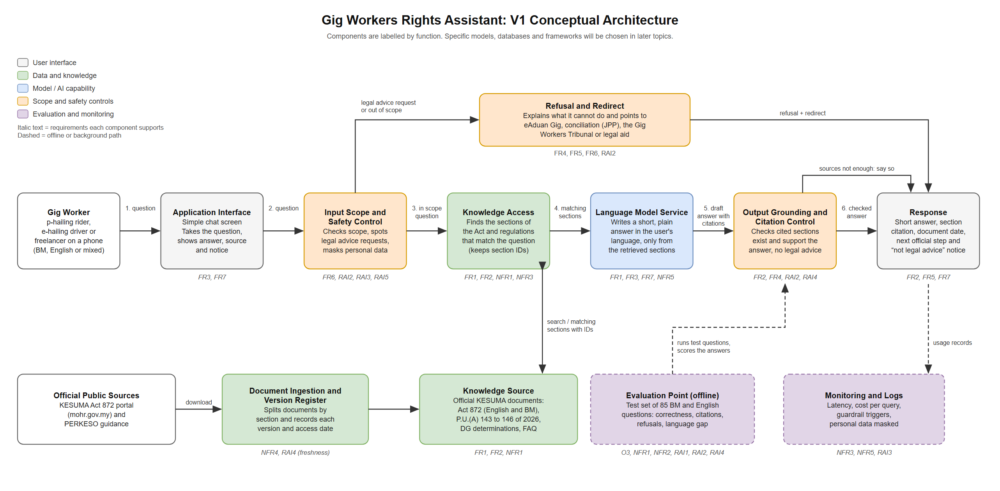

# Week 2 V1 Architecture and Design Decisions: Gig Workers Rights Assistant

**Course:** SAIA 3113 AI Engineering, Universiti Teknologi Malaysia
**Student:** Kaveetiran A/L Sitambaram (A24AI0038)
**Version:** 1.0
**Based on:** [`week2_requirements.md`](week2_requirements.md) and [`week2_evaluation_criteria.md`](week2_evaluation_criteria.md)

---

## Step C1: Starting from the Simplest Architecture

The simplest version would be:

**Gig worker question, then Chat interface, then Language model, then Answer**

I checked this against my requirements. It could handle FR3 (BM and English) and FR7 (short, plain answers) because a language model can already do that. But it fails most of the important requirements:

1. A language model on its own does not reliably know Act 872, which only came into force in March 2026. It may not have it in its training data at all, so it cannot meet FR1 or NFR1.
2. It cannot point to a real section of a document, so it cannot meet FR2, NFR2 or RAI4.
3. Nothing stops it from giving personal legal advice or answering unrelated questions, so it cannot meet FR6 or RAI2.
4. Personal data typed by the user would go straight to the model, so it cannot meet RAI3.
5. There is no way to show it is good enough, so O3 cannot be achieved.

So I added components only where a requirement needs them, as shown below.

---

## Step C2: Architecture Needs from the Requirements

| Requirement ID | What does the requirement need? | Architecture response |
|---|---|---|
| FR1, NFR1 | Answers must come from the actual text of Act 872 and its regulations, which the model may not know. | **Knowledge Source** of official KESUMA documents plus a **Knowledge Access** component that finds the matching sections for each question. |
| FR2, NFR2, RAI4 | Every answer must cite a section that exists and supports it. | Knowledge Access keeps section IDs with each retrieved passage, and an **Output Grounding and Citation Control** checks the cited sections before the answer is shown. |
| FR4, RAI4 | The system must say when the sources are not enough instead of guessing. | The Output Grounding and Citation Control sends a "not enough information" response when no retrieved section supports the answer. |
| FR6, RAI2 | Personal legal advice, case predictions and out of scope topics must be refused and redirected. | **Input Scope and Safety Control** before retrieval, plus a **Refusal and Redirect** path to eAduan Gig, conciliation, the Tribunal or legal aid. |
| FR5 | Workers need to know the official next step for their situation. | The Response includes the next step, and the Refusal and Redirect path holds the list of official channels. |
| RAI3 | Personal identifiers must not be sent to the model or stored. | The Input Scope and Safety Control masks personal data before anything leaves the application, and Monitoring and Logs only store masked records. |
| RAI5 | Instructions hidden in pasted text must not change the rules. | The Input Scope and Safety Control treats pasted text as data, and the Output control checks the final answer still follows the rules. |
| NFR4, freshness | New regulations or updated documents must be added quickly and old versions must not be quoted as current. | **Document Ingestion and Version Register** splits documents by section and records version and access date, so one document can be updated without rebuilding the rest. |
| O3, NFR1, NFR2, RAI1, RAI2 | The system must be tested against thresholds, including the gap between BM and English. | **Evaluation Point (offline)** that runs the 85 question test set through the full pipeline and scores the answers. |
| NFR3, NFR5 | Latency and cost must stay within targets. | **Monitoring and Logs** record response time, cost per query and guardrail triggers. Keeping the main path short (one retrieval step and one model call) helps latency. |

---

## Step C3: V1 Conceptual Architecture

The diagram is saved as [`week2_architecture_v1.png`](week2_architecture_v1.png). The editable Draw.io version is [`week2_architecture_v1.drawio`](week2_architecture_v1.drawio), which can be opened at app.diagrams.net. It uses the same colour convention as the Week 1 system map:

| Colour | Meaning | Components |
|---|---|---|
| Grey / white | User and interface | Gig Worker, Application Interface, Response |
| Green | Data and knowledge | Official Public Sources, Document Ingestion and Version Register, Knowledge Source, Knowledge Access |
| Blue | Model / AI capability | Language Model Service |
| Orange | Scope and safety controls | Input Scope and Safety Control, Output Grounding and Citation Control, Refusal and Redirect |
| Purple | Evaluation and monitoring | Evaluation Point (offline), Monitoring and Logs |

**Main flow:**

1. The worker types a question in the Application Interface.
2. The Input Scope and Safety Control checks the question. If it asks for personal legal advice or is out of scope, it goes to Refusal and Redirect. Personal data is masked.
3. An in scope question goes to Knowledge Access, which finds the matching sections in the Knowledge Source.
4. The Language Model Service writes a short answer in the user's language using only those sections, with citations.
5. The Output Grounding and Citation Control checks that each cited section exists and supports the answer. If not, the user is told the sources are not enough.
6. The Response shows the answer, section citation, document date, the next official step and the "not legal advice" notice.

The components are labelled by what they do, not by product. The specific model, retrieval method, storage and interface will be chosen in later topics.

---

## Step C4: Architecture Decision Records

| Decision | Requirement / Constraint | Alternatives Considered | Selected Option | Trade-off Accepted |
|---|---|---|---|---|
| **ADR1: Include knowledge access over official documents** | FR1, FR2, NFR1, NFR2. Answers must come from Act 872, which the model may not know because the law is new. | (a) Language model only. (b) Put the whole Act into every prompt. (c) Retrieve only the matching sections for each question. | (c) Knowledge Access that retrieves matching sections and keeps their section IDs. | More components to build and an extra step that adds some latency. Retrieval can also miss the right section, which then has to be tested. In return answers are grounded and each one can be traced to a section. Option (b) was rejected because the Act, regulations and FAQ together are long, which would raise cost per query (NFR5) and make it harder to point to the exact section. |
| **ADR2: Separate scope control before retrieval and citation control after generation** | FR4, FR6, RAI2, RAI4. Legal advice must be refused and unsupported answers must not be shown. | (a) Rely on instructions in the prompt only. (b) One check at the input. (c) A check at the input and a check at the output. | (c) Input Scope and Safety Control plus Output Grounding and Citation Control. | Two extra processing steps, which add latency and cost, and some useful questions may be wrongly refused. This is why the evaluation tracks the false refusal rate (≤ 10%) as well as the refusal rate. I accepted this because a confident but wrong legal answer is worse for a worker than a refusal that points them to KESUMA. |
| **ADR3: Track document versions in a register instead of a one time load** | NFR4, RAI4 (freshness). The law is new, so more regulations and official determinations are likely during the semester. | (a) Load the documents once and rebuild everything when something changes. (b) A version register that records each document's version and date and allows one document to be replaced on its own. | (b) Document Ingestion and Version Register. | More work at the start (recording metadata and splitting by section), but updates become quick (target under 15 minutes) and every answer can show which version of the law it used. |
| **ADR4: Use an external language model service for V1** | Time and budget constraints (one student, one semester, Colab environment) and FR3 (good BM and English). | (a) Host an open model myself. (b) Use a hosted model through an API. | (b) Hosted language model service, with personal data masked before any request is sent. | Faster to build and better language quality, but it creates dependency on an outside provider, adds a running cost, and means user text leaves the system. This is why RAI3 masking happens before the model call and why cost is monitored. The model can be swapped later because it sits behind a single service component. |

---

## Initial Requirements Traceability Matrix

| Objective | Requirement | Evaluation Criterion | Architecture Element | Later Evidence |
|---|---|---|---|---|
| O1 | FR1, NFR1 | Answer correctness on Act 872 (≥ 80% correct) | Knowledge Source, Knowledge Access, Language Model Service | Scored results on the 45 in scope test questions |
| O1 | FR2, NFR2, RAI4 | Section citation and support (100% presence, ≥ 90% accuracy) | Knowledge Access (section IDs), Output Grounding and Citation Control | Citation check results for every in scope answer |
| O1 | NFR4 | Document update time (< 15 min) | Document Ingestion and Version Register | Timed update test using a new regulation |
| O2 | FR6, RAI2 | Refusal of legal advice and out of scope requests (≥ 95%, false refusal ≤ 10%) | Input Scope and Safety Control, Refusal and Redirect | Results on the 20 scope and safety queries plus false refusal count on in scope questions |
| O2 | RAI3 | Personal data not sent or stored (0 detections) | Input Scope and Safety Control (masking), Monitoring and Logs | Inspection of outgoing model requests and logs during privacy tests |
| O3 | RAI1, FR3 | Language parity (≤ 10 point gap, ≥ 95% language match) | Language Model Service, Knowledge Source (English and BM Act), Evaluation Point | Side by side BM and English results on the parallel test set |
| O3 | NFR3, NFR5 | Latency and cost (p90 < 5 s, < US$0.50 per 100 queries) | Monitoring and Logs, short main path | Latency and cost report from the full evaluation run |

---

## Final Review Checklist

**Does each major component support a requirement or evaluation need?**
Yes. Every component in the diagram is tagged with the requirements it supports, and each one appears in the Step C2 table or the traceability matrix.

**Is any important data source, safety control or evaluation point missing?**
Two things are not in V1 on purpose. First, there is no user feedback component. It would help later, but no current requirement depends on it. Second, the optional "paste your service agreement" feature from Week 1 is not included yet, because it would need extra controls for long pasted text and is not part of the V1 objectives. Both can be added in a later version if the requirements change.

**Have I added any technology or component that is not yet justified?**
No specific technologies are named. The Language Model Service, Knowledge Access and the controls are described by function only.

**Is there a simpler architecture that could still satisfy the requirements?**
I considered merging the input and output controls into one, but they check different things. The input control works on the question (scope, advice requests, personal data) and the output control works on the answer (citations and support). Merging them would make RAI2 and RAI4 harder to test separately. I also considered dropping the version register, but then NFR4 and freshness could not be met. So I think this is close to the simplest version that still meets the requirements.

---

## Reflection

**Which architecture decision involved the most important trade-off? Which requirement drove the decision, and what trade-off did you accept?**

ADR2, adding separate scope and citation controls, involved the most important trade-off. It was driven mainly by RAI2 (no personal legal advice) and RAI4 (every answer must be supported by a real section). The trade-off is that the system becomes slower and more cautious. Some genuine questions will be refused or answered with "not enough information" when a simpler chatbot would have answered them, and workers might find that frustrating. I accepted this because the users are gig workers who often cannot afford to lose income, and a confident wrong answer about something like a suspension or a deduction could make them give up a valid claim. To keep the trade-off under control, I set a false refusal limit (≤ 10%) in the evaluation criteria, so I will know if the controls are making the system too strict.
