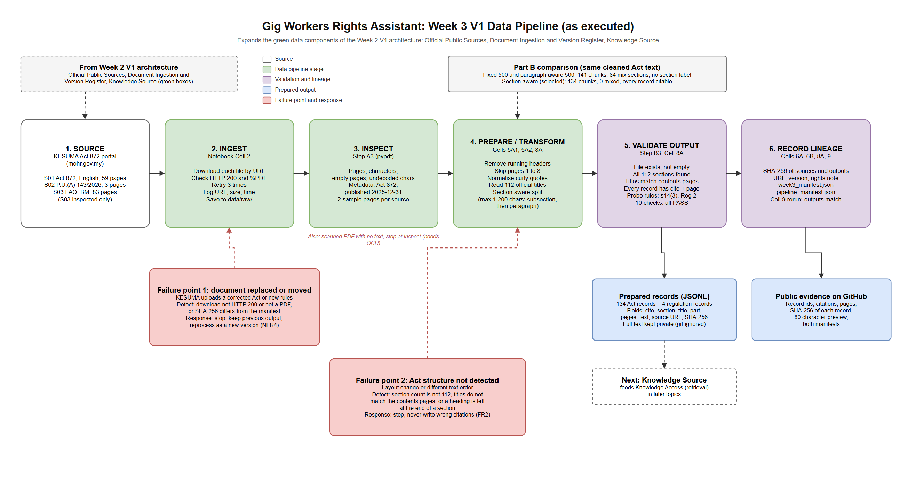

# Week 3 Pipeline Decisions: Gig Workers Rights Assistant

**Course:** SAIA 3113 AI Engineering, Universiti Teknologi Malaysia
**Student:** Kaveetiran A/L Sitambaram (A24AI0038)
**Version:** 1.0
**Notebook:** [`notebooks/week3_pipeline.ipynb`](../notebooks/week3_pipeline.ipynb)
**Diagram:** [`week3_pipeline_diagram.png`](week3_pipeline_diagram.png) (editable: [`week3_pipeline_diagram.drawio`](week3_pipeline_diagram.drawio))

---

## 1. What this pipeline is for

In the Week 2 V1 architecture, the green **Official Public Sources, Document Ingestion and Version Register, and Knowledge Source** boxes feed the Knowledge Access component. This pipeline is the first working version of those boxes. It turns the official PDFs into section level records that the later retrieval step (Topic 5 onwards) can search and cite.

| Topic 2 requirement | What the pipeline does for it |
|---|---|
| FR1, NFR1 | Extracts the full legal text of Act 872 and P.U.(A) 143/2026 |
| FR2, NFR2, RAI4 | Keeps the section number, title, Part, pages and a ready made citation ("Act 872, Section 14") on every record |
| NFR4, freshness (ADR3) | Records source URL, gazette publication date and SHA-256 for every file, so a changed file is detected and the pipeline can be rerun in minutes |
| RAI3 (privacy) | No personal data is involved: all sources are public legal documents |

**Selected sources:** S01 Act 872 (English) and S02 P.U.(A) 143/2026 (English page). S03, the KESUMA FAQ, was inspected but is not prepared yet (see section 6). Details are in [`week3_data_inventory.md`](week3_data_inventory.md).

---

## 2. Part B Comparison: Which Chunking Approach?

All three approaches were run on the **same cleaned text of Act 872** (70,116 characters after cleaning). The numbers below are copied from the notebook output (Step B3).

| Approach | Chunks | Average characters | Chunks mixing 2 or more sections | Chunks starting at a section, subsection, paragraph or definition | Chunk knows its section | Probe: Section 14(3) "not exceeding fourteen days" |
|---|---|---|---|---|---|---|
| A: Fixed size, 500 characters (lab template) | 141 | 497 | 84 (60%) | 1 | No | Phrase cut across two chunks, no section label |
| B: Paragraph aware, 500 characters (lab template) | 141 | 497 | 84 (60%) | 1 | No | Same as A |
| C: Section aware, at most 1,200 characters (selected) | 134 | 494 | 0 | 134 (100%) | Yes, for all 134 | Whole phrase in one record labelled Section 14 |

**Key observation:** the paragraph aware method produced **exactly the same output** as the fixed method. pypdf does not produce blank lines between paragraphs in this PDF (0 blank line breaks in the cleaned text), so the paragraph splitter never finds a paragraph and falls back to fixed slicing. This means the lab's paragraph aware method is not suitable for this document, and a method based on the Act's own numbering is needed.

**Lab comparison format:**

| Approach / Configuration A | Approach / Configuration B | Observed Evidence | Selected Approach and Trade-off |
|---|---|---|---|
| Fixed size, 500 characters (also identical to paragraph aware for this PDF) | Section aware, at most 1,200 characters, split long sections at subsection, definition, then paragraph | A: 141 chunks, 84 mix two or more sections, only 1 starts at a legal boundary, no section labels, the Section 14(3) rule is cut in half. B: 134 chunks, 0 mixed, all start at a legal boundary, all labelled, all 112 sections found and titles match the Act's contents pages. | **Section aware.** Benefit: every record can be cited to an exact section (FR2, NFR2, RAI4) and a rule is never cut mid sentence. Accepted limitation: chunk sizes vary (70 to 1,194 characters), and the second or third piece of a long section loses the opening words of that section. This is reduced by putting the section number and title at the top of every piece. |

---

## 3. Chosen Configuration and Cleaning Decisions

| Setting | Value | Evidence from inspection |
|---|---|---|
| Method | Section aware | Sections start with "N. " at the beginning of a line, numbered 1 to 112 in order |
| Section detection | Only the next expected number (1, then 2, then 3 ...) starts a new section | Stops list items such as "9. Photography" in the Schedule from being mistaken for Section 9 |
| Maximum size | 1,200 characters | 14 of 112 sections are longer than this (for example Section 2, Interpretation, at about 3,100 characters) |
| Splitting long sections | Subsection "(2)" or definition first, then paragraph "(a)", then "; " | No fixed size cut was needed (0 fallback cuts) |
| Remove running headers | Yes | Every page starts with "Gig Workers N" or "N / Laws of Malaysia Act 872" |
| Skip front matter | Yes, pages 1 to 8 | Cover, copyright page and Arrangement of Sections would otherwise be indexed as if they were law |
| Use the Arrangement of Sections | Read for official titles only | Gives the official title of all 112 sections, used to label records and to validate detection |
| Move marginal headings | Yes, 111 headings moved back to their own section | The heading is extracted just before the section number, so it would otherwise sit at the end of the previous section |
| Curly quotes | Changed to straight quotes | Definitions are written as “term” means ..., one quote style lets one rule find each definition |
| S02 | English page 3 only, signature lines removed | Page 2 is BM, page 3 is English |

**Validation results (notebook Step B3), all PASS:** all 112 sections present; every title matches the Arrangement of Sections; every record has a citation and page; no record above 1,200 characters; no undecoded characters; no section ends with the next section's heading; the Section 14(3) fourteen day rule is in a Section 14 record; the 1.25% rate is in Regulation 2; record ids are unique; every chunk starts at a section, subsection, paragraph or definition.

---

## 4. ETL or ELT, Batch or Streaming

**ETL with raw retention.** The pipeline extracts, transforms (cleans and chunks) and then loads prepared records, because the retrieval step needs clean, labelled records, not raw PDF text. The raw PDFs are also kept in `data/raw/` during a run, so the documents can be reprocessed with a different configuration without downloading again. This gives some of the flexibility of ELT while keeping the stored output ready to use.

**Batch, not streaming.** The sources are laws and regulations that change rarely (a new regulation or amendment every few months at most). A batch run takes under a minute, so the pipeline is rerun whenever KESUMA publishes or replaces a document. Streaming would add complexity with no benefit for this data.

---

## 5. Stage Contracts and Failure Responses

| Stage | Contract / evidence | Failure response |
|---|---|---|
| Ingest | Each chosen source downloads from the official KESUMA URL with HTTP 200 and starts with `%PDF`. URL, size and time are logged. | Retry 3 times, then **stop** with a clear error. Never continue with a partial or HTML error page. |
| Inspect | Every page has extractable text (0 empty pages expected). Page count, characters and undecoded characters are recorded. | **Stop** if no text is found (scanned PDF would need OCR). Flag if undecoded characters appear. |
| Prepare | Act yields exactly 112 sections and 112 official titles. Regulations yield exactly 3. Chunks are at most 1,200 characters. | **Stop and report** if the count is different (for example a layout change or an amended Act). Do not write a partly wrong knowledge source. |
| Validate | Output files exist, are non empty, SHA-256 recorded, plus the 10 project content checks. | **Stop** for missing or empty output or any failed content check. |
| Record lineage | Every source links to its exact output with source and output SHA-256, record count, version and rights note. Cell 6B re-checks every fingerprint. | **Stop and report** if a mapping or fingerprint does not match. |

### Two important failure points (also shown in the diagram)

**Failure point 1: KESUMA replaces or moves a document.**
The law is new, so KESUMA may upload a corrected Act or new regulations under the same or a different URL. *Detection:* the download fails (non 200 or not a PDF), or the SHA-256 of the new file is different from the one in the manifest. *Response:* stop, keep the previous prepared output, and reprocess the new version as a new batch with its new publication date. This links to NFR4 (update in under 15 minutes) and the freshness risk in the Week 2 requirements.

**Failure point 2: the Act's structure is not detected correctly.**
If the layout changes (for example a new PDF printer) or pypdf extracts text in a different order, section numbers or headings might be missed, which would attach text to the wrong section and break citations. *Detection:* the section count is not 112, the titles do not match the Arrangement of Sections, or a section ends with the next section's heading. *Response:* stop the pipeline instead of writing records with wrong citations. This protects FR2, NFR2 and RAI4.

A third, smaller risk is a scanned PDF with no text layer, which is caught by the inspect stage.

---

## 6. Accepted Limitations

1. **English only for now.** The BM versions of the Act and regulations are not prepared yet, so BM questions will rely on the model to bridge languages. This affects RAI1 (language parity) and will be revisited in Topic 4.
2. **FAQ not prepared yet.** S03 has a question and answer structure that needs its own splitter. It will be added in a later iteration as supporting guidance, with the Act always cited first.
3. **Later pieces lose the opening words of a section.** For example Section 42 part 3 starts at paragraph "(n)". The header line ("Section 42: Award of Tribunal, part 3 of 4") keeps the context.
4. **Pages are recorded per section, not per piece.** A piece of Section 14 lists pages 16 to 18 even if it only sits on page 17.
5. **Schedule table is flattened.** The table of non platform gig services becomes a single text record with repeated column labels.
6. **Small spacing errors in S02** ("t he", "purpose s") come from the source PDF and are kept as they are, so the text stays faithful.
7. **Repeatability, not full reproducibility.** Cell 9 shows the same input gives the same output on the same setup. A different pypdf version could extract text slightly differently, so the pypdf version (6.21.4 in the recorded run) should be noted with each run.

---

## 7. Provenance and Access Caveat

Act 872 page 2 says: "All rights reserved. No part of this publication may be reproduced ... without the prior permission of Percetakan Nasional Malaysia Berhad." The documents are public and free to download, but republishing the full text in a public repository could count as reproducing it. So:

* the raw PDFs and the full prepared text are **not committed** (they are listed in `.gitignore`);
* the repository holds **public evidence** instead: record ids, citations, pages, sizes, SHA-256 fingerprints and an 80 character preview per record;
* anyone can rebuild the full files by running the notebook, which downloads the documents from the official URLs, and check them against the fingerprints.

This follows the lab instruction to commit only non-sensitive evidence when data should not be redistributed.

---

## 8. Traceability to Topic 2

| Objective | Requirement | Evaluation criterion (Week 2) | Architecture element (Week 2) | Week 3 evidence |
|---|---|---|---|---|
| O1 | FR1, NFR1 | Answer correctness (≥ 80%) | Knowledge Source | 134 Act records covering all 112 sections, and 4 regulation records (`week3_manifest.json`) |
| O1 | FR2, NFR2, RAI4 | Section citation and support (100% presence, ≥ 90% accuracy) | Knowledge Access (section IDs), Output Grounding and Citation Control | Every record has `cite`, `section`, `title`, `pages`. Titles checked against the Arrangement of Sections (PASS). |
| O1 | NFR4 | Document update time (< 15 minutes) | Document Ingestion and Version Register | Full batch run takes under a minute. Source SHA-256 and publication date stored in both manifests. |
| O3 | RAI1 | Language parity (≤ 10 point gap) | Knowledge Source (English and BM Act) | Not met yet: only English is prepared. Logged as limitation 1. |

---

## Reflection

The most useful lesson this week was that the lab's paragraph aware chunker gave exactly the same result as the fixed size chunker on my data. I would not have noticed that if I had only checked that the code ran without errors. The reason is that pypdf does not output blank lines for this PDF, so there are no paragraphs to find. For a legal document, the real structure is the numbering of sections and subsections, and using that structure gave 0 mixed chunks instead of 84 and made every record citable. It also showed me why validation has to check content, not just that a file exists: checking that all 112 sections were found and that their titles match the Act's own contents pages is what gives me confidence that the citations will be right later.
